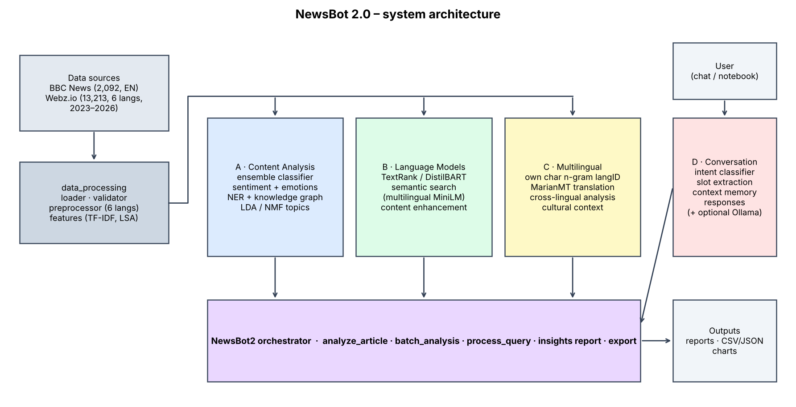

# 🤖 NewsBot Intelligence System 2.0

**ITAI 2373 – Natural Language Processing · Final Project (Solo)**
**Author:** Mourinho Hernanto · **Team:** Solo · **Date:** December 2026

[](https://colab.research.google.com/github/Haryapandhita/ITAI2373-NewsBot-Final/blob/main/ITAI2373-NewsBot-Final/notebooks/07_System_Integration.ipynb)
&nbsp;·&nbsp; Built on my midterm: [ITAI2373-NewsBot-Midterm](https://github.com/Haryapandhita/ITAI2373-NewsBot-Midterm)

NewsBot 2.0 is a multilingual news-intelligence platform. It reads news in **six languages**, classifies it with
**calibrated confidence**, tracks **sentiment and topics over time**, maps **who is connected to whom**, writes
**summaries and headlines**, searches by **meaning**, and answers questions in a **chat interface that remembers
context** ("show me negative tech news from 2025" → "only the German ones" → "summarize them").

| | |
|---|---|
| 📄 Technical documentation | [`docs/technical_documentation.md`](docs/technical_documentation.md) · PDF in `reports/` |
| 👤 User guide (with FAQ) | [`docs/user_guide.md`](docs/user_guide.md) |
| 🔧 API reference | [`docs/api_reference.md`](docs/api_reference.md) (generated from docstrings) |
| 🚀 Deployment | [`docs/deployment_guide.md`](docs/deployment_guide.md) · [`docs/deployment_instructions.md`](docs/deployment_instructions.md) |
| 💼 Executive summary | `reports/executive_summary.pdf` |
| 🙋 Individual contributions | [`docs/individual_contributions.md`](docs/individual_contributions.md) |

---

## ✨ Highlights (all numbers reproduced by `scripts/run_experiments.py`)

| Capability | Result |
|---|---|
| Category classification, BBC test set | **97.4% accuracy**, 5-fold CV macro-F1 **0.980** (midterm: 96.2%) |
| Robustness to new vocabulary – 2023–26 news | BBC-only model **68.8% → NewsBot 2.0 83.0%** (+14.2 pts) |
| Confidence you can trust | 0.8–1.0 confidence bin: 97% predicted vs 99% observed; flagged articles 38% vs unflagged 84% correct |
| Entity recognition with original casing | **+92%** entities found vs the lower-cased midterm data |
| Topic discovery (NMF) | NPMI coherence ≈ 0.43 vs ≈ 0.20 for LDA |
| Own language detector (6 languages) | **98.6%** accuracy on 100 characters (langdetect: 97.3%) |
| Chatbot intent understanding | **97.7%** on hand-written held-out questions |
| Speed | ≈ 0.1 s per article for the full analysis (CPU, no GPU) |

## 🏗️ Architecture



| Module | What it does | Main files |
|---|---|---|
| **A · Content Analysis** | ensemble classifier (confidence, multi-label, explanations); sentence-level sentiment + emotions + temporal anomalies; NER, relation extraction, knowledge graph; LDA/NMF topics with coherence & trends | `src/analysis/` |
| **B · Language Understanding & Generation** | TextRank / DistilBART summaries, headlines, quality metrics; hybrid semantic search with query expansion; grounded content enhancement | `src/language_models/` |
| **C · Multilingual Intelligence** | own character n-gram language ID; MarianMT translation + round-trip quality; cross-language coverage, tone, entity perspectives, story linking, cultural context | `src/multilingual/` |
| **D · Conversational Interface** | intent classification, slot extraction, context memory for follow-ups & multi-part questions, grounded responses (+ optional Ollama) | `src/conversation/` |
| **Orchestrator** | `NewsBot2` – build, `analyze_article`, `batch_analysis`, `chat`, insights report, export | `src/newsbot.py` |

Every transformer component (Sentence-Transformers, DistilBART, MarianMT, XLM-R) has a **classical fallback**, so
the system runs on any laptop and automatically upgrades in Google Colab.

## 📊 Data

| Dataset | Size | Why |
|---|---|---|
| [BBC News](https://github.com/jonathanporta/bbc-news-article-archive) (Greene & Cunningham 2006) – original casing + headlines | 2,092 articles, 5 categories, 2004–05 | supervised training/testing, NER, summarisation |
| [Webz.io free news datasets](https://github.com/Webhose/free-news-datasets) – 20 snapshots | 13,150 articles, **6 languages**, **Dec 2023 – Nov 2026** | multilingual analysis, topic & sentiment evolution, cross-domain testing |

Raw text is **not** stored in this repository (copyright / terms of use); it is downloaded automatically on first run.

## 🚀 Quick start

**Google Colab (recommended):** click the badge above → *Runtime → Run all* (optional: *T4 GPU* for transformer
models). Each notebook installs everything it needs.

**Local:**
```bash
git clone https://github.com/Haryapandhita/ITAI2373-NewsBot-Final.git
cd ITAI2373-NewsBot-Final/ITAI2373-NewsBot-Final
pip install -r requirements.txt
python -m spacy download en_core_web_sm && python -m spacy download xx_ent_wiki_sm
python -m pytest -q                      # 29 tests
python scripts/run_experiments.py        # rebuilds the system + every result and figure
```

```python
from src.newsbot import NewsBot2
bot = NewsBot2().build()                                   # first run ~8–10 min on CPU, then cached
bot.analyze_article("Apple unveiled a new AI chip on Tuesday ...")
bot.chat("How has sentiment about China changed over time?")
bot.chat("Compare Spanish and German politics news")
```

## 📓 Notebooks

| Notebook | Content |
|---|---|
| `01_Data_Exploration` | loading, validation, composition, preprocessing, language-label check |
| `02_Advanced_Classification` | baselines vs ensemble, calibration, explanations, domain shift, multi-label, sentiment, NER + knowledge graph |
| `03_Topic_Modeling` | LDA vs NMF, coherence-based model selection, intertopic map, topic & sentiment evolution, anomalies |
| `04_Language_Models` | summarisation, headlines, quality metrics, semantic search, query expansion, clustering, content enhancement |
| `05_Multilingual_Analysis` | language detection, translation quality, cross-lingual coverage/tone/entities, story linking, cultural context |
| `06_Conversational_Interface` | intent model, slot extraction, full chatbot with follow-ups, optional Ollama |
| `07_System_Integration` | end-to-end analysis, batch processing, robustness tests, reports/export, test suite, results summary |

## 📁 Repository structure

```
ITAI2373-NewsBot-Final/
├── README.md · requirements.txt · .gitignore
├── config/            settings.py (NewsBotConfig) · api_keys_template.txt
├── src/
│   ├── data_processing/   data_loader · text_preprocessor · feature_extractor · data_validator
│   ├── analysis/          classifier · sentiment_analyzer · ner_extractor · topic_modeler
│   ├── language_models/   summarizer · generator · embeddings
│   ├── multilingual/      translator · language_detector · cross_lingual_analyzer
│   ├── conversation/      query_processor · intent_classifier · response_generator
│   ├── utils/             visualization · evaluation · export · logging_utils
│   └── newsbot.py         NewsBot2 orchestrator
├── notebooks/         01–07 (Colab-ready)
├── tests/             test_preprocessing · test_classification · test_topic_modeling · test_integration
├── scripts/           run_experiments · colab_setup · make_notebooks · make_api_reference · build_reports
├── data/              raw/ · processed/ (downloaded/generated, git-ignored) · models/ · results/ (metrics.json, figures)
├── docs/              technical_documentation · user_guide · api_reference · deployment_guide ·
│                      individual_contributions · deployment_instructions
└── reports/           executive_summary.pdf · technical_report.pdf · presentation_slides.pdf
```

## ⚠️ Limitations

* Webz categories/sentiment are produced by Webz's own models and snapshots are pre-filtered by sentiment → temporal
  sentiment trends are indicative.
* On clean BBC data all strong linear models score 97–98%; the 2.0 gains are robustness (new vocabulary) and calibrated
  confidence rather than raw BBC accuracy.
* Lexicon sentiment (~70% agreement with external labels) misreads sarcasm and domain language.
* Small spaCy models make NER errors, especially on non-English scraped text.
* The intent test set was used during template development; accuracy on new questions will be somewhat lower.
* Without GPU/transformers: extractive summaries only, LSA search (no cross-lingual retrieval), no machine translation.
  The transformer path (DistilBART, MarianMT, multilingual MiniLM) was verified in Colab (T4 GPU, transformers 5.x);
  the reported metrics come from the CPU fallback run.

## 🙋 My contributions

Solo project – I designed and implemented every module, the experiments, documentation and presentation. Details:
[`docs/individual_contributions.md`](docs/individual_contributions.md). AI assistance (Claude, Anthropic) was used for
drafting code/documentation and debugging, as allowed by the course; all results were produced by running the code.

## 👤 About the author

Mourinho Hernanto – Artificial Intelligence student at Houston City College, interested in turning unstructured text
into decisions people can trust. Contact: mourinhoreno8@gmail.com

## 📚 References

See §13 of the [technical documentation](docs/technical_documentation.md#13-references). Key libraries: scikit-learn,
spaCy, vaderSentiment, NRCLex, networkx, Hugging Face Transformers, Sentence-Transformers, MarianMT (OPUS-MT),
sacreBLEU, rouge-score, plotly, matplotlib.
