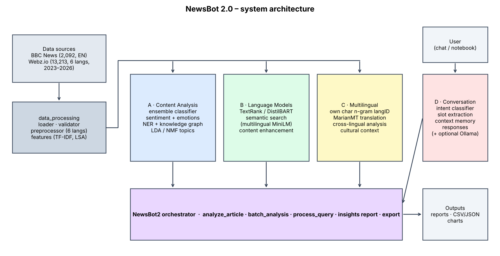
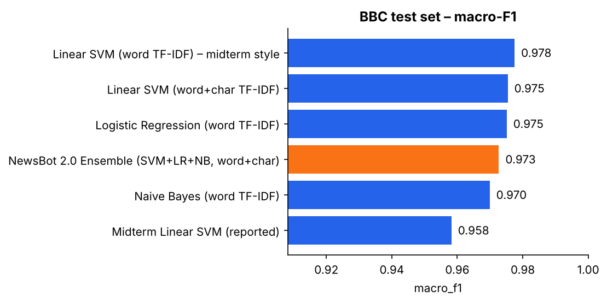
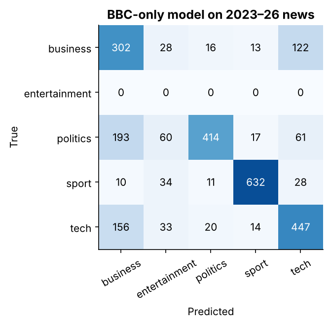
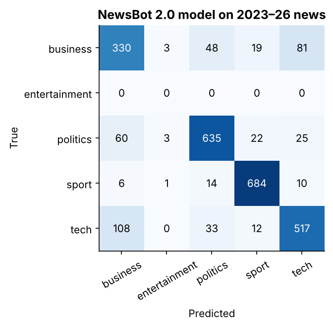
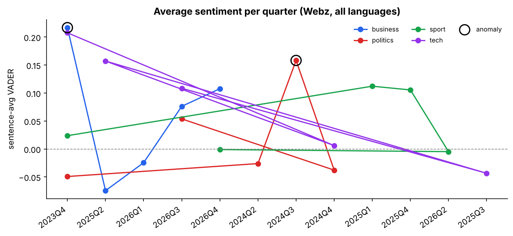
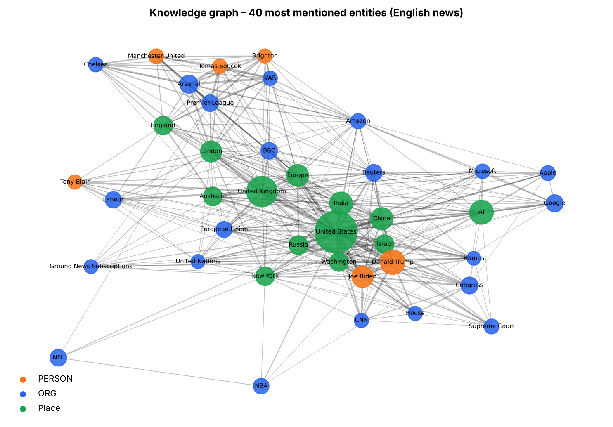
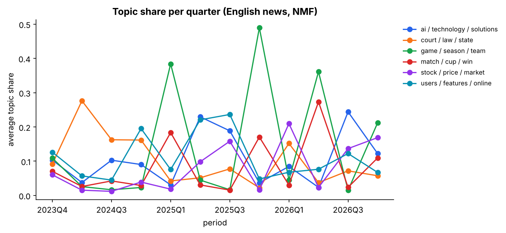
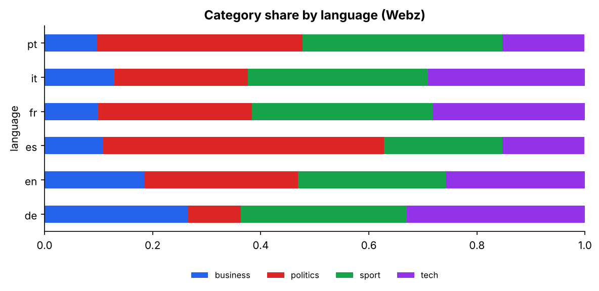
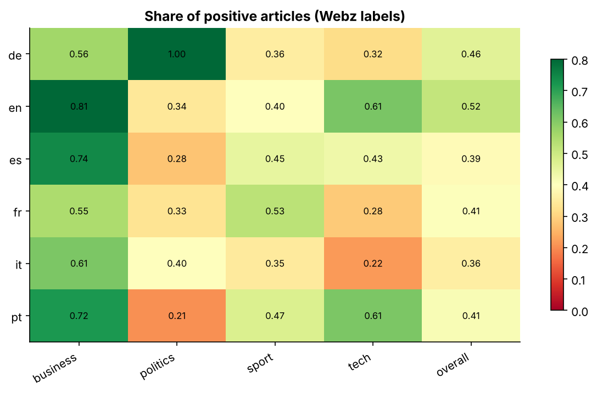

<div class="cover">
<h1>NewsBot Intelligence System 2.0</h1>
<div class="sub"><b>Technical Documentation</b> · ITAI 2373 Natural Language Processing · Final Project<br>
Mourinho Hernanto (team: Solo) · Houston City College · December 2026<br>
Repository: github.com/Haryapandhita/ITAI2373-NewsBot-Final</div>
</div>

<div class="kpi"><b>97.4%</b><span>BBC test accuracy<br>(CV macro-F1 0.980)</span></div><div class="kpi"><b>69→83%</b><span>accuracy on 2023–26 news<br>after domain adaptation</span></div><div class="kpi"><b>6</b><span>languages · 15,242 articles<br>Dec 2023 – Nov 2026</span></div><div class="kpi"><b>97.7%</b><span>chatbot intent accuracy<br>(held-out questions)</span></div>

## 1. Overview

NewsBot 2.0 turns a large, multilingual stream of news into answers. It extends the midterm NewsBot (a single
Colab notebook that classified BBC articles and extracted entities and sentiment) into a modular Python package
with four integrated modules:

| Module | Capability | Key techniques |
|---|---|---|
| **A · Content Analysis** | classification with confidence, sentiment & emotions over time, entities & relations, topics | soft-voting ensemble (SVM + LR + NB, word + char TF-IDF), sentence-level VADER + NRC, spaCy NER + dependency relations + knowledge graph, LDA/NMF with NPMI coherence |
| **B · Language Understanding & Generation** | summaries, headlines, semantic search, context enrichment | TextRank + MMR, DistilBART, hybrid dense/sparse search (multilingual MiniLM or LSA), grounded enhancement |
| **C · Multilingual Intelligence** | language ID, translation, cross-language comparison, cultural context | own char n-gram classifier, MarianMT + round-trip chrF, entity-alias normalisation, story linking |
| **D · Conversational Interface** | natural-language questions with follow-ups | template-bootstrapped intent classifier, rule + NER slot filling, dialogue memory, optional local LLM (Ollama) |

**Verified in Google Colab** (T4 GPU, Python 3.13, transformers 5.x, 25 Nov 2026): the full notebook 07 runs end-to-end
with all 29 tests passing; DistilBART produces abstractive summaries on CUDA, MarianMT translates
(*"El Banco Central Europeo subió los tipos de interés…"* → *"The European Central Bank raised interest rates to curb
inflation."*), and the multilingual MiniLM retrieves cross-lingually (an English article about Apple's AI chip returned
German articles about Google's AI smartphones as nearest neighbours). Because transformers 5 removed the
`summarization`/`translation` pipelines, NewsBot calls `AutoModelForSeq2SeqLM.generate` directly
(`src/language_models/seq2seq.py`). All quantitative results below were produced on CPU with the classical fallbacks,
so they are a lower bound for search and summarisation quality.

**Design principles.** (1) *Graceful degradation*: every transformer component has a classical fallback, so the
system runs on any laptop and improves automatically in Colab. (2) *Grounding*: generated text is assembled only
from facts the system computed. (3) *Measured, not assumed*: every claim in this document is produced by
`scripts/run_experiments.py` and stored in `data/results/metrics.json`.

## 2. System architecture


<div class="figure">Figure 1 – Data flows from the two corpora through shared preprocessing into modules A–C; the
orchestrator combines them and module D exposes everything through conversation.</div>

### 2.1 Repository layout

```
ITAI2373-NewsBot-Final/
├── config/settings.py            # NewsBotConfig dataclass – every path, model name, threshold
├── src/
│   ├── data_processing/          # data_loader, text_preprocessor, data_validator, feature_extractor
│   ├── analysis/                 # classifier, sentiment_analyzer, ner_extractor, topic_modeler
│   ├── language_models/          # summarizer, embeddings (semantic search), generator (enhancement, Ollama)
│   ├── multilingual/             # language_detector, translator, cross_lingual_analyzer
│   ├── conversation/             # intent_classifier, query_processor, response_generator
│   ├── utils/                    # visualization, evaluation, export, logging_utils
│   └── newsbot.py                # NewsBot2 orchestrator
├── notebooks/01…07               # tutorial + evaluation notebooks (Colab-ready)
├── tests/                        # 29 pytest tests (unit + integration)
├── scripts/                      # run_experiments, colab_setup, make_api_reference, build_reports
├── data/{raw,processed,models,results}
└── docs/ · reports/
```

### 2.2 Component interaction

`NewsBot2.build()` executes a fixed pipeline and caches every expensive artefact:

| Step | Component | Output | Time (CPU) |
|---|---|---|---|
| 1 | `data_loader.load_all` | cleaned BBC + Webz DataFrames | download once, then <1 s |
| 2 | `NewsClassifier.train` | ensemble on BBC train + 2,400 recent Webz articles | 35 s |
| 3 | `LanguageDetector.train` | char n-gram model (6 languages) | 3 s |
| 4 | `_enrich` | language check, sentiment, emotions, entity list per article | 229 s |
| 5 | `build_knowledge_graph` | 10.7k-node entity graph from 4,000 English articles | 110 s |
| 6 | `TopicModeler` (NMF, k = 15) | topic model on all English articles | 17 s |
| 7 | `SemanticSearchEngine.encode_documents` | dense + sparse index of 15,242 articles | 74 s |
| 8 | `IntentClassifier`, `QueryProcessor` | chatbot ready | <1 s |

At query time `analyze_article(text)` runs: language detection → (translation) → classification → sentiment →
entities → relations → entity sentiment → topics → summary → headlines → enhancement. **Each step is wrapped in
its own error handler**; a failing step is reported in `result["errors"]` and the remaining steps still run.
`process_query(message)` splits multi-part messages, parses each part into a `ParsedQuery` (intent + slots), merges
it with the conversation context for follow-ups, executes it against the corpus and formats the answer.

## 3. Data

| | BBC News (Greene & Cunningham, 2006) | Webz.io free news datasets |
|---|---|---|
| Role | supervised training/testing, NER, summarisation | multilingual + temporal analysis, cross-domain test |
| Size used | 2,092 articles (133 exact duplicates removed) | 13,150 articles after cleaning (20 weekly snapshots) |
| Languages | English | en 8,648 · es 2,252 · de 632 · pt 624 · fr 537 · it 457 |
| Time span | 2004–2005 (no dates) | Dec 2023 – Nov 2026 (dated) |
| Labels | 5 categories | 4 categories (Webz IPTC mapping), sentiment, source country |

**Midterm limitation fixed.** The midterm used the Kaggle copy of BBC, which is lower-cased with punctuation stripped.
NewsBot 2.0 loads the original archive (with casing and headlines). On 150 test articles spaCy finds
**3,279 PERSON/ORG/GPE entities with original casing vs 1,709 on the lower-cased text (+92%)**.

**Data-quality pipeline.** `data_validator.validate_corpus` checks columns, empty/short texts, duplicate ids and
texts, class imbalance, lower-casing and missing dates. Scraped Webz pages are cleaned (URLs, boilerplate lines),
truncated to 12,000 characters, de-duplicated by text and by (title, site), and filtered to ≥ 40 words. During the
build, NewsBot's own language detector re-checks every Webz language label; **63 articles whose label disagreed with
a confident detection (e.g. a Vietnamese page tagged German) were removed**.

**Licensing.** Neither corpus is redistributed: both are downloaded on first run (BBC content © BBC; Webz.io terms
grant a non-transferable licence). Only derived models and aggregate results are in the repository.

## 4. Module A – Advanced Content Analysis

### 4.1 Classification (`src/analysis/classifier.py`)

**Model.** A pipeline of word 1–2-gram TF-IDF ∪ character 3–5-gram TF-IDF feeding a soft-voting ensemble:
calibrated Linear SVM (weight 2), logistic regression and Complement Naive Bayes, all class-balanced. Text is
normalised by `TextPreprocessor.normalize`; the vectorisers are fitted inside the pipeline, so cross-validation is
leakage-free.

**Outputs.** `predict_with_confidence` returns the label, calibrated probability, the margin to the runner-up, all
class probabilities, **secondary labels** (≥ 0.20, for multi-topic stories) and `needs_review` (confidence < 0.55 or
margin < 0.15). `explain_prediction` lists the terms that pushed the decision (word-level LR contributions) and the
most similar training articles.

| Model (same BBC split: 1,673 train / 419 test) | Accuracy | Macro-F1 |
|---|---|---|
| Midterm Linear SVM (reported, lower-cased Kaggle data) | 0.962 | 0.958 |
| Naive Bayes, word TF-IDF | 0.971 | 0.970 |
| Logistic Regression, word TF-IDF | 0.976 | 0.975 |
| Linear SVM, word 1–2-gram TF-IDF (midterm style) | **0.979** | **0.978** |
| Linear SVM, word + char TF-IDF | 0.976 | 0.975 |
| **NewsBot 2.0 ensemble** | 0.974 | 0.973 |

*5-fold CV macro-F1 of the ensemble on the training split: 0.980 ± 0.004.*

**Interpretation (honest).** On clean BBC data all strong linear models are tied at 97–98%; differences below one
point equal one to four articles and are within noise. The gain over the midterm comes mainly from the better data.
The ensemble is kept because it produces **calibrated probabilities**: in the 0.8–1.0 confidence bin (395 test
articles) mean confidence is 0.972 and observed accuracy 0.990; in the 0.6–0.8 bin, 0.70 vs 0.80. A plain SVM gives no
probabilities at all, so it could not drive the review flag or multi-label output.



**Domain shift – the real test.** A model trained only on 2004–05 BBC news was applied to 2,611 held-out English
Webz articles from 2023–26 (business, politics, sport, tech). Accuracy fell to **68.8%** – words such as *AI*,
*crypto* or *streaming* barely exist in the training data, and modern business/tech stories were often sent to
"entertainment". The NewsBot 2.0 classifier is trained on the BBC training split **plus** 600 recent articles per
category (test articles excluded): accuracy on the 2023–26 test set rose to **83.0%** (+14.2 points) while BBC test
accuracy stayed at 96.4%. Macro-F1 on Webz (0.56 → 0.65) is lower than accuracy because predictions into the
"entertainment" class, which Webz lacks, count as a zero-F1 class.

 

**Review flag works.** On 400 recent articles 9.2% were flagged; unflagged articles were classified correctly
84.3% of the time, flagged ones only 37.8% – the flag concentrates the errors where a human should look.

**Non-English articles.** The TF-IDF model reaches 69–81% on Spanish, German, French, Italian and Portuguese
articles only through shared names and cognates. In production NewsBot classifies the MarianMT English translation;
alternatively `EmbeddingClassifier` uses multilingual sentence embeddings for zero-shot transfer (notebook 02 §6).

### 4.2 Sentiment and emotions (`src/analysis/sentiment_analyzer.py`)

* **Sentence-averaged VADER** with news-domain lexicon corrections ("party", "penalty", "shares" neutral; "recession",
  "killed" negative). Whole-article VADER saturates beyond ±0.9 for **71.4%** of articles, which makes articles
  incomparable; averaging per sentence removes this.
* Agreement with Webz's positive/negative labels (3,000 English articles): whole-text VADER 68.3%, sentence average
  69.9%. The improvement in agreement is small; the main benefit is non-saturated, comparable scores.
* Confidence = share of sentences agreeing with the overall direction; most positive/negative sentences returned
  as evidence; **entity-level sentiment** averages the sentences mentioning each entity.
* **NRC emotions** (8 Plutchik emotions) read directly from the lexicon bundled with `nrclex`.
* Optional multilingual transformer (`cardiffnlp/twitter-xlm-roberta-base-sentiment`) for non-English text.
* **Temporal tracking**: `track_over_time` (mean, count, std per period × group) and `detect_anomalies` (z-score
  ≥ 1.5 within each category). Flagged: business 2023Q4 (z = 1.53) and politics 2024Q3 (z = 1.77).


<div class="figure">Figure 2 – Mean sentence-level sentiment per quarter and category (all six languages). Caveat: each
Webz snapshot was pre-selected by sentiment, so swings partly reflect snapshot selection.</div>

### 4.3 Entities, relations and knowledge graph (`src/analysis/ner_extractor.py`)

* spaCy `en_core_web_sm` (English) and `xx_ent_wiki_sm` (other languages); labels harmonised (PER → PERSON, LOC → GPE).
* **Normalisation/linking**: titles and possessives removed; 90+ aliases map variants and translations to one name
  (*UK/Britain/Reino Unido → United Kingdom*, *EE.UU./Vereinigte Staaten → United States*, *Trump → Donald Trump*);
  within an article a bare surname links to the full name used earlier.
* **Relation extraction** from the dependency parse: subject–verb–object triples between entities, appositions with a
  role word ("Tim Cook, chief executive of Apple" → `ROLE_AT`) and compound roles ("Microsoft boss Bill Gates").
* **Knowledge graph** (`networkx`): nodes carry type, mention count and category counts; edges carry co-occurrence
  weight and typed relations. Built from 4,000 English articles: **10.7k nodes, 34.4k edges, 7.5k edges with typed
  relations** (most frequent: ROLE_AT 649, TELL, HAVE, SAY, WIN, ANNOUNCE). `find_entity_connections` returns direct
  links or the strongest indirect paths (edge cost = 1/weight); `entity_profile` gives background for enhancement.



### 4.4 Topic modelling and evolution (`src/analysis/topic_modeler.py`)

* LDA (counts) and NMF (TF-IDF) behind one interface; unigrams + bigrams; scraped-web boilerplate words removed
  (e.g. "read article", cookie banners and a media-rating widget that formed their own topics in a first run).
* **NPMI coherence** implemented from document co-occurrence (Bouma 2009; Röder et al. 2015) and **topic diversity**
  (Dieng et al. 2020) drive model selection on 5,000 English articles:

| Method | k = 8 | k = 10 | k = 12 | k = 15 | k = 16 | k = 20 |
|---|---|---|---|---|---|---|
| NMF – NPMI / diversity | 0.405 / 0.95 | 0.442 / 0.94 | 0.419 / 0.93 | 0.436 / 0.94 | – | 0.459 / 0.91 |
| LDA – NPMI / diversity | 0.191 / 0.84 | – | 0.200 / 0.77 | – | 0.228 / 0.78 | – |

NMF is about twice as coherent as LDA on short, noisy web news. NMF coherence is flat between k = 10 and 20, so
**k = 15** was chosen as the balance between coherence, diversity (k = 20 starts repeating words) and granularity.
The final model (all English articles) reaches NPMI 0.43, diversity 0.93 and 0.77 purity against the categories –
topics align with sections but are finer-grained (software & devices, US courts, AI industry, health research,
Israel/Ukraine/Russia, stock markets, economy, film awards, UK and US politics, NBA, Premier League clubs …). One
junk topic made of hexadecimal fragments ("cd / ed / ce", 1.3% of documents) remains from scraped page code.
`track_topic_trends` gives topic shares per quarter; `emerging_topics` ranks growth (largest increases 2023Q4 →
2026Q4: "stock/price/market" +10.9 pts and "game/season/team" +10.3 pts).
`visualize_topics` produces an interactive intertopic-distance map (MDS on Jensen–Shannon distances).



## 5. Module B – Language Understanding & Generation

**Summarisation** (`summarizer.py`). Three strategies behind `summarize_article(text, summary_type, method)`:
*lead* (first sentences), *TextRank* (implemented here: TF-IDF sentence graph, PageRank, 15% position prior, MMR
redundancy removal) and *abstractive* (`sshleifer/distilbart-cnn-12-6`, automatic fallback to TextRank).
`summarize_multiple_articles` pools lead sentences of several articles, optionally re-weights them toward a focus
topic and runs TextRank+MMR across the pool. `generate_headlines` returns informative, keyword and social variants.
`assess_summary_quality` reports ROUGE (when a reference exists), compression, entity coverage, redundancy and
novel-word ratio. On 300 BBC test articles: generated informative headlines vs the real BBC headline reach
**ROUGE-1 0.25 / ROUGE-L 0.23**; balanced extractive summaries compress articles to ~21% and keep ~34% of the key
entities with <4% repeated bigrams.

**Semantic search** (`embeddings.py`). `SemanticEmbedder` uses the multilingual
`paraphrase-multilingual-MiniLM-L12-v2` when available (one vector space for 50+ languages → cross-lingual retrieval)
and otherwise LSA (TF-IDF + 256-dim SVD). `SemanticSearchEngine.semantic_search` scores
0.6 × dense + 0.4 × sparse similarity, applies metadata filters (category, language, sentiment, date range, ids) and
**query expansion** (news synonym map + LSA term neighbours, e.g. *ai → artificial intelligence, machine learning,
generative*). Also: `find_similar_articles`, `cluster_similar_content` (k-means story clusters) and
`detect_near_duplicates` (syndication). Category precision@10 with the offline LSA backend: **0.78** (300 queries).
Typical LSA error: "football transfer window" returned American-football stories – exactly the ambiguity the
transformer backend resolves in Colab.

**Content enhancement** (`generator.py`). `ContentEnhancer.enhance_article` adds entity background from the
knowledge graph (mentions, main section, frequent co-mentions), related coverage, tone relative to the category
(e.g. "more positive than 93% of tech articles") and numeric facts. `cross_reference_facts` flags numbers whose
context matches a related article but whose value differs – candidates for a human fact-check, never an automatic
verdict. `generate_insights` and `detect_information_gaps` produce corpus-level findings and under-covered groups.

## 6. Module C – Multilingual Intelligence

**Language detection** (`language_detector.py`) – our own model: TF-IDF over 1–4 character n-grams + multinomial
logistic regression, trained on 5,361 sentence snippets from 300 articles per language; returns confidence, top
alternatives, a reliability flag and per-sentence segmentation for mixed-language text.

| Input length (unseen articles, 6 languages) | 20 chars | 50 chars | 100 chars | 300 chars |
|---|---|---|---|---|
| NewsBot detector – accuracy | 0.793 | 0.954 | **0.986** | **0.992** |
| `langdetect` baseline | – | – | 0.973 | – |

**Translation** (`translator.py`). MarianMT models (Helsinki-NLP opus-mt es/fr/de/it→en, Romance→en for Portuguese,
and the reverse directions) loaded on demand and cached; long articles are translated sentence by sentence.
Quality is estimated **without references** by round-trip translation scored with chrF, plus length ratio and
copied-token share. Fallbacks: `deep-translator` if installed, otherwise the original text with `translated=False`.

**Cross-lingual analysis** (`cross_lingual_analyzer.py`) on the 13,150 Webz articles:

* *Coverage differs by language*: Spanish sources are 52% politics, German 33% tech and only 10% politics, French and
  Italian lean to sport (33–34%).
* *Tone differs*: share of positive articles (Webz labels) ranges from 36% (Italian) and 39% (Spanish) to 52% (English).
* *Regional perspectives*: Donald Trump appears in 4–5% of articles in every language, but only 23% of English and
  15% of Portuguese mentions are positive vs 35–36% in Spanish and French.
* *Entity overlap* of the top-50 entities is low (Jaccard 0.02–0.24) – each language follows its own domestic agenda
  (77–93% of articles come from "home" countries).
* *Story linking* matched 15 same-event pairs across languages via ≥3 shared entities within 7 days (e.g. an NBA
  game reported in Spanish and English, Canadian sanctions on settlers in French and Spanish).
* *Cultural context*: institutions, leagues and indices that need explaining (Moncloa, Bundestag, Ibovespa, CAC 40 …)
  and currencies are detected per language.

 

## 7. Module D – Conversational Interface

* **Intent classifier** (`intent_classifier.py`): no public dataset exists for "questions to a news bot", so 960
  training queries are generated from templates × slot values (13 intents: search, summarize, sentiment, compare,
  topics, trends, entity, classify, translate, insights, export, help, greeting). Word + char TF-IDF + logistic
  regression. On 43 hand-written questions with different wording: **accuracy 0.977, macro-F1 0.983**.
  *Caveat*: templates were extended after a first error analysis on this set, so performance on fresh questions will
  be somewhat lower.
* **Slot extraction** (`query_processor.py`): categories (with synonyms), sentiment words, six languages, relative and
  absolute dates (today, this week, last month, last year, 2025, Q3 2025, March 2026 – relative to the newest article),
  result counts, summary length, export format, pasted article text, and entities (known-entity gazetteer from the
  knowledge graph + spaCy + capitalisation, with surname resolution "Trump" → "Donald Trump").
* **Context management**: `ConversationContext` stores the previous query, its slots and result ids. Follow-ups
  ("what about last year?", "only negative ones", "summarize them") inherit missing slots and, when appropriate, the
  intent; multi-part messages ("… and then summarize them") are split and executed in order. User interests are
  counted for personalised suggestions.
* **Responses** (`response_generator.py`) are template-based and grounded; an optional local LLM (Ollama) may rephrase
  the draft but is instructed to use only the given facts. Median response time in the demo transcript: 53 ms.

```
🧑 Show me positive tech news from this year     🤖 5 matching articles [tech · en · 2026-08-13 · positive] …
🧑 what about last year?                          🤖 same filters, 2025 date range
🧑 only negative ones                             🤖 same filters, sentiment = negative
🧑 summarize them                                 🤖 multi-document summary of the previous results
🧑 How are Donald Trump and China connected?      🤖 appear together in 19 articles; relations: get, back
```

## 8. Installation guide

**Colab:** open any notebook → *Run all* (first cell runs `scripts/colab_setup.py`: clone, `pip install -r
requirements.txt`, spaCy models). **Local:** Python 3.10–3.13,

```bash
git clone https://github.com/Haryapandhita/ITAI2373-NewsBot-Final.git
cd ITAI2373-NewsBot-Final/ITAI2373-NewsBot-Final
pip install -r requirements.txt
python -m spacy download en_core_web_sm && python -m spacy download xx_ent_wiki_sm
python -m pytest -q                       # 29 tests
python scripts/run_experiments.py         # data download + full build + all results (~12 min CPU)
```

## 9. Configuration manual

All settings are fields of `config.settings.NewsBotConfig`; a modified copy can be passed to `NewsBot2(config)`
(e.g. `dataclasses.replace(DEFAULT_CONFIG, n_topics=20)`).

| Setting | Default | Purpose / tuning advice |
|---|---|---|
| `webz_snapshots`, `languages` | 20 snapshots, 6 languages | add snapshots for more time coverage; languages need a MarianMT model for translation |
| `min_words`, `max_chars` | 40, 12,000 | drop stubs / truncate scraped pages |
| `use_transformers` (`NEWSBOT_USE_TRANSFORMERS`) | on | off = classical fallbacks, < 2 GB RAM |
| `embedding_model`, `summarization_model` | multilingual MiniLM, DistilBART-CNN | any Sentence-Transformers / HF summarisation model |
| `low_confidence`, `secondary_label_min` | 0.55, 0.20 | raise to send more articles to human review / return fewer secondary labels |
| `langid_min_confidence` | 0.60 | below → "und" (undetermined) |
| `n_topics` | 15 | chosen by NPMI; use `select_n_topics` after changing the corpus |
| `search_top_k` | 5 | default number of chatbot results |
| `use_llm`, `ollama_host`, `ollama_model` | off | local LLM polishing of chatbot replies |

`build(max_webz=…, kg_docs=…)` trades completeness for speed (the integration test uses 1,500 / 300).

## 10. API reference (summary)

The complete, generated reference is `docs/api_reference.md`. Main entry points:

| Call | Returns |
|---|---|
| `NewsBot2(config, use_transformers).build(data=None, max_webz=None, kg_docs=4000, retrain=False)` | ready system |
| `bot.analyze_article(text, title="", summary_type="balanced", enhance=True)` | dict: language, translation, classification, sentiment, entities, relations, entity_sentiment, topics, summary, headlines, enhancements, cultural_context, errors |
| `bot.batch_analysis(texts)` | DataFrame, one row per article |
| `bot.chat(message)` / `bot.process_query(message)` | reply text / reply + parsed intents, slots and data |
| `bot.generate_insights_report(df=None)` · `bot.export_article_report(analysis, path, fmt)` | Markdown report · file |
| `NewsClassifier().train(texts, labels).predict_with_confidence(text)` | `Prediction` |
| `TopicModeler(k, "nmf").fit_transform(docs)` · `.topics_table()` · `.track_topic_trends(dates)` | topic matrix · table · trends |
| `SemanticSearchEngine(embedder).encode_documents(df).semantic_search(query, top_k, filters)` | DataFrame |
| `LanguageDetector().train(X, y).detect_language(text)` · `Translator().translate_text(text, src)` | dict · dict |

## 11. Testing and performance

29 pytest tests: preprocessing and validation (10), classifier/sentiment/language-ID/intents (9), topics, summaries
and search (6), integration (5 – follow-ups, multi-part queries, cultural context, exports, and a full end-to-end
build on a data sample). Full analysis takes ≈ 0.1 s per article on CPU without transformers (batch of 44 mixed-language articles: 99 ms/article); batch analysis never
stops on a bad article; empty input is rejected with a clear error; very long, gibberish and mixed-language inputs
are handled (notebook 07 §4).

## 12. Limitations, ethics and future work

* **Labels are noisy.** Webz categories and sentiment come from Webz's own models; snapshots are pre-filtered by
  sentiment, so temporal sentiment swings partly reflect sampling. Results are indicative, not ground truth.
* **Lexicon sentiment** misreads sarcasm and domain language (~70% agreement with external labels).
* **Small spaCy models** miss or mislabel entities, especially in non-English and scraped text (e.g. "AI" as GPE;
  German security advisories dominate German entity counts).
* **Bias.** The corpus is English- and US-heavy; source selection shapes what the system "knows". Tone comparisons
  between languages must not be read as statements about nations. Generated text is grounded to avoid fabrication,
  and low-confidence predictions are routed to humans.
* **Privacy & licensing.** Public news only; raw text not redistributed.
* **Future work:** fine-tune a multilingual transformer classifier (XLM-R) on BBC + Webz; transformer NER and
  coreference; dynamic topic models; a web front end (Streamlit/Flask) on top of `NewsBot2`; live RSS ingestion.

## 13. References

Greene, D. & Cunningham, P. (2006). Practical solutions to the problem of diagonal dominance in kernel document
clustering. *ICML*. · Webz.io free news datasets, github.com/Webhose/free-news-datasets. · Hutto, C. & Gilbert, E.
(2014). VADER. *ICWSM*. · Mohammad, S. & Turney, P. (2013). NRC Emotion Lexicon. *Computational Intelligence*
29(3). · Mihalcea, R. & Tarau, P. (2004). TextRank. *EMNLP*. · Carbonell, J. & Goldstein, J. (1998). MMR. *SIGIR*.
· Lee, D. & Seung, H. (1999). NMF. *Nature*. · Blei, D., Ng, A. & Jordan, M. (2003). LDA. *JMLR*. · Bouma, G. (2009).
NPMI. *GSCL*. · Röder, M. et al. (2015). Exploring the space of topic coherence measures. *WSDM*. · Dieng, A. et al.
(2020). Topic modeling in embedding spaces. *TACL*. · Reimers, N. & Gurevych, I. (2019/2020). Sentence-BERT;
multilingual knowledge distillation. *EMNLP*. · Lewis, M. et al. (2020). BART. *ACL*. · Tiedemann, J. & Thottingal, S.
(2020). OPUS-MT. *EAMT*. · Popović, M. (2015). chrF. *WMT*. · Lin, C.-Y. (2004). ROUGE. · Honnibal, M. et al. spaCy. ·
Pedregosa, F. et al. (2011). scikit-learn. *JMLR*. · Hagberg, A. et al. (2008). NetworkX.

*AI assistance: an AI assistant (Claude, Anthropic) was used for drafting code and documentation and for debugging,
as allowed by the course; see `docs/individual_contributions.md`.*
